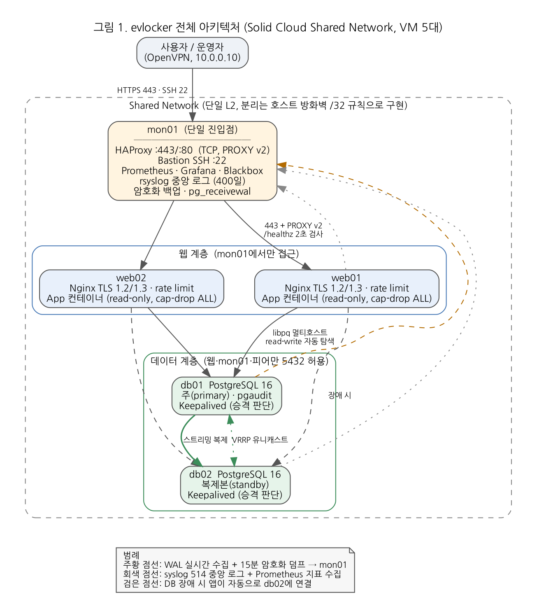

# evlocker · 디지털 증거 보관함 인프라

인프라 설계 및 구축 최종 과제 (32191170 김진우)

- 저장소: https://github.com/pieon29/evlocker
- 보고서: [docs/REPORT.md](docs/REPORT.md) (PDF: docs/REPORT.pdf)
- 우선순위: 1순위 보안·규제, 2순위 가용성
- 플랫폼: Solid Cloud (Apache CloudStack) Shared Network, Terraform으로 VM 5대·리소스 22개 배포



## 구성

| 노드 | 역할 |
|---|---|
| mon01 | 단일 진입점: HAProxy(PROXY protocol v2) + Bastion, Prometheus·Grafana, 중앙 로그(400일), 암호화 백업, WAL 실시간 수집 |
| web01, web02 | Nginx(TLS 1.2/1.3, 실제 접속자 IP 기준 요청 제한) + 앱 컨테이너(읽기 전용, capability 전부 제거) |
| db01, db02 | PostgreSQL 16 스트리밍 복제, Keepalived 자동 승격, 앱은 libpq 멀티호스트로 주 DB 자동 탐색 |

- 분리: 호스트 방화벽(ufw)과 pg_hba를 상대 IP(/32) 단위로 제한. 외부에서 닿는 포트는 mon01의 22·80·443뿐
- 설계 변경: VPC 3계층으로 구축했으나 가상 라우터의 DHCP·user-data 전달이 VM마다 불안정해 Shared Network로 전환 (보고서 8장)

## 측정 결과 요약

| 항목 | 결과 |
|---|---|
| 배포 | `terraform apply` 5분 19초, 콘솔 수작업 0건 |
| 평상시 성능 (20명, 3분) | 74.5 req/s, p95 35.2ms, 실패 0건 |
| 처리 한계 | 약 400 req/s에서 p95 307ms, 병목은 웹 서버 CPU |
| 웹 장애 | web01 중단 시 요청 1건 실패, 자동 제외·재투입 |
| S1 DB 장애 | RTO 7.6초, RPO 0건, 자동 승격 |
| S4 토큰 대입 공격 | 46초 만에 경보, 50초 만에 공격 IP 추적·차단 |
| 백업 복원 | 7초, 건수 일치 |

## 실행 방법

```bash
cd terraform
cp terraform.tfvars.example terraform.tfvars
# api_key, secret_key, shared_network_id, repo_ref, app_image 입력 (이 파일은 커밋하지 않음)
terraform init
terraform apply
cd ..
bash scripts/ssh-setup.sh
bash scripts/check-all.sh
```

| 스크립트 | 용도 |
|---|---|
| `scripts/check-all.sh` | 서비스·차단·부트스트랩·복제·LB·백업·모니터링 일괄 점검 |
| `scripts/scenario-web.sh` | 웹 서버 장애 재현과 측정 |
| `scripts/scenario-db.sh` | S1 주 DB 장애 재현과 RTO·RPO 측정 |
| `scripts/scenario-s4.sh` | S4 위조 토큰 대입·폭주 → 탐지·추적·차단 |
| `scripts/port-audit.sh` | 외부 노출 포트와 방화벽 규칙 점검 |
| `scripts/policy-check.sh` | Rego 정책 검사 |

## 문서

- [docs/REPORT.md](docs/REPORT.md): 설계, 워크플로우, 측정, 시나리오, 한계
- [docs/troubleshooting.md](docs/troubleshooting.md): 문제 해결 12건
- [docs/static-analysis.md](docs/static-analysis.md): CI 정적 분석과 조치
- [ai-log.md](ai-log.md): AI 활용과 AI가 틀린 사례
- [THIRD_PARTY.md](THIRD_PARTY.md): 사용한 오픈소스

모든 증거 데이터는 테스트용 더미 파일이다.
