# 1. 개요

## 1.1 서비스와 목표

evlocker는 수사·감사 기관이 디지털 증거 파일을 보관하고, 누가 언제 열람했는지를 위·변조할 수 없게 남기는 **디지털 증거 보관함**이다. 모든 데이터는 과제용 더미 파일이다.

| 기능 | 구현 |
|---|---|
| 증거 등록 | 파일 본문을 AES-256-GCM으로 암호화해 저장하고, SHA-256 해시를 함께 기록 |
| 열람·다운로드 | 역할 기반 토큰(수사관 / 감사관)으로 접근을 제한하고, 다운로드 시 해시를 다시 검증 |
| 보관 이력(Chain of Custody) | 등록·열람·다운로드마다 이전 이력의 해시를 이어 붙인 해시 체인을 기록. DB 트리거로 수정·삭제·TRUNCATE 차단 |
| 이력 검증 | `/custody` API가 체인 전체를 다시 계산해 `chain_valid`를 반환 |

## 1.2 우선순위와 그 이유

| 순위 | 항목 | 이유 |
|---|---|---|
| 1 | **보안·규제** | 증거는 무결성과 접근 기록이 법적 효력을 좌우한다. 공공 영역에서는 개인정보 보호법과 「개인정보의 안전성 확보조치 기준」의 접근통제·접속기록·암호화 요건을 충족해야 한다 |
| 2 | **가용성** | 2025년 9월 국가정보자원관리원 대전 본원 화재로 다수의 정부 정보시스템이 장기간 중단된 사례처럼, 공공 시스템은 단일 장애점과 백업 위치를 설계 단계에서 다뤄야 한다 |
| 3 | 성능·비용 | 증거 보관 업무는 요청량이 크지 않다. 학생 할당량(8 vCPU, 16GB, 120GB) 안에서 목표 응답 시간만 만족하면 된다 |

## 1.3 핵심 결과 요약

| 영역 | 목표 | 측정 결과 |
|---|---|---|
| 구축 | Terraform만으로 재현 | 리소스 22개, 전체 apply **5분 18초**, 콘솔 수작업 0건 |
| 성능 | 평상시 p95 < 300ms | 20명 동시 접속 74.5 req/s에서 **p95 35.2ms**, 실패 0건 |
| 처리 한계 | 병목 식별 | 약 **400 req/s**에서 p95 307ms. 병목은 웹 서버 CPU(약 75%) |
| 가용성 (웹) | 무중단 | web01 중단 시 요청 **1건** 실패, 자동 제외·재투입 |
| 가용성 (DB, S1) | 자동 전환 | **RTO 7.6초**, **RPO 0건**, 사람 개입 없이 승격 |
| 보안 사고 (S4) | 탐지·추적·차단 | 공격 시작 **46초** 만에 경보, **50초** 만에 공격 IP 차단 |
| 백업 | 복구 가능성 입증 | 암호화 백업 복원 **7초**, 증거·이력 건수 운영 DB와 일치 |
| 노출 면 | 진입점 하나 | 외부에서 열린 포트는 mon01의 22·80·443뿐 |

# 2. 요구사항과 설계 원칙

## 2.1 보안·규제 요구사항 매핑

| 근거 | 요구 내용 | 이 인프라에서의 구현 | 검증 |
|---|---|---|---|
| 안전성 확보조치 기준 (접근통제) | 권한 없는 접근 차단, 외부 접속 제한 | 진입점 mon01 하나. web·db는 mon01과 필요한 상대 IP(/32)만 허용. SSH 키 인증만 허용, root 로그인 금지 | 포트 점검(6.5절), 직접 접속 차단 확인 |
| 안전성 확보조치 기준 (접속기록) | 접속자·접속 일시·접속지·처리 내용을 기록하고 일정 기간 이상 보관 | Nginx 접속 로그에 **실제 접속자 IP** 기록(PROXY protocol), 앱 인증 실패 로그, 중앙 로그 서버 400일 보관 | S4에서 공격 IP를 중앙 로그로 추적 |
| 안전성 확보조치 기준 (암호화) | 전송·저장 시 암호화 | 외부 TLS 1.2/1.3, DB 연결 TLS 강제(hostssl, scram-sha-256), 파일 본문 AES-256-GCM, 백업 AES-256 암호화 | 설정 파일, 백업 복호화 훈련 |
| 증거 무결성 | 위·변조 방지와 사후 검증 | 해시 체인 + 수정·삭제 차단 트리거 + 다운로드 시 해시 재검증 | pytest 8건, `/custody` 검증 API |
| N2SF (국가망 보안체계) | 업무정보를 등급(C/S/O)으로 분류하고 등급별 통제 적용 | 증거 데이터는 S(민감) 이상으로 보고 데이터 계층을 외부와 직접 연결하지 않음 | 데이터 계층 외부 노출 포트 0개 |
| 공급망 보안 | 취약한 이미지·설정 배포 차단 | CI에서 Trivy 이미지 게이트, checkov·tflint·trivy config, gitleaks, Rego 정책 | 정적 분석 기록(5.4절) |

## 2.2 설계 원칙

1. **모든 자원은 Terraform으로.** 콘솔은 조회만 한다. 설정 변경도 `terraform apply`로 반영한다.
2. **시크릿은 코드·user-data에 두지 않는다.** Terraform이 생성한 값은 SSH로 전달하고, 파일 권한 0600으로 둔다.
3. **최소 노출.** 외부에서 닿는 곳은 한 곳이고, 내부 통신은 상대 IP 단위로만 허용한다.
4. **장애는 사람보다 먼저 시스템이 처리한다.** 웹은 상태 검사로 자동 제외하고, DB는 자동 승격한다. 사람은 원인 분석과 정상화를 맡는다.
5. **측정하지 않은 것은 주장하지 않는다.** 모든 수치는 `evidence/` 폴더의 원본 파일과 대응된다.

# 3. 아키텍처

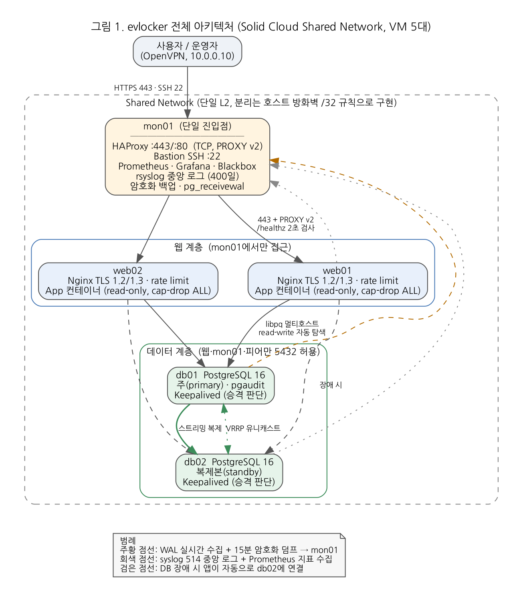

## 3.1 구성 요소

| 노드 | 사양 | 역할 |
|---|---|---|
| mon01 | Small (1 vCPU, 2GB, 20GB) | 단일 진입점. HAProxy(443/80, TCP 모드, PROXY v2), Bastion SSH, Prometheus·Grafana·Blackbox, 중앙 로그(rsyslog, 400일 보관), 15분 주기 암호화 덤프, 매일 전체 백업, WAL 실시간 수집 |
| web01, web02 | Small × 2 | Nginx(TLS 종료, 실제 IP 복원, 접속자별 요청 제한, 보안 헤더) + 앱 컨테이너(Flask + gunicorn, 읽기 전용 루트, 모든 capability 제거, 메모리 512MB 제한) |
| db01, db02 | Small × 2 | PostgreSQL 16 스트리밍 복제, pgaudit, Keepalived(VRRP 유니캐스트)로 승격 판단 |

할당량은 VM 8대, 120GB이다. VM당 루트 디스크가 20GB라 실제 상한은 6대다. 5대를 쓰고 1대는 웹 증설용 여유로 남겼다(Rego 정책 EVL-006·007로 강제).

## 3.2 네트워크와 분리 방식

Solid Cloud의 **Shared Network**(단일 L2)에 5대를 배치했다. 처음에는 VPC 3계층(web / data / mgmt)으로 구축했다. 하지만 VPC 가상 라우터의 DHCP·user-data 전달이 VM마다 불안정해서 전환했다(8장). 그래서 계층 분리를 네트워크 대신 **각 호스트의 방화벽(ufw)과 pg_hba**에서 상대 IP 단위로 구현했다.

| 대상 | 허용 포트 | 허용 출발지 |
|---|---|---|
| mon01 | 22, 80, 443 | 전체 (유일한 진입점) |
| mon01 | 514 (syslog) | web01, web02, db01, db02 |
| mon01 | 9100 | 모니터링 컨테이너 대역(172.30.0.0/24) |
| web01, web02 | 22, 80, 443, 8443, 9100, 9113 | mon01만 |
| db01, db02 | 5432 | web01, web02, mon01, 상대 DB |
| db01, db02 | 22, 9100, 9187 | mon01만 |
| pg_hba | 역할별 DB 접근 | evl_app은 웹 IP만, replicator는 DB IP만, evl_backup은 mon01만. 모두 `hostssl` + scram-sha-256 |

**트레이드오프.** VPC의 네트워크 ACL은 호스트가 침해되어도 우회할 수 없다. 반면 호스트 방화벽은 root 권한을 얻은 공격자가 끌 수 있다. 이를 보완하려고 SSH를 키 인증과 `AllowUsers ubuntu`로 제한하고, 방화벽 규칙을 부트스트랩이 매번 처음부터 다시 만들게 했다(설정 드리프트 방지). 실제 공공기관 환경이라면 네트워크 계층 분리(망분리, 보안그룹)를 함께 적용해야 한다.

## 3.3 고가용성 설계

| 계층 | 방식 | 장애 감지 | 전환 |
|---|---|---|---|
| 웹 | HAProxy 라운드로빈 + `/healthz` L7 검사 | 2초 간격, 2회 연속 실패 | 자동 제외, 2회 연속 성공 시 자동 재투입 |
| DB | 스트리밍 복제 + Keepalived | `pg_isready` 2초 간격 3회 실패 | 대기 DB가 상대가 여전히 주 DB인지 확인한 뒤 승격(스플릿 브레인 방지) |
| DB 연결 | libpq 멀티호스트 `host=db01,db02 target_session_attrs=read-write` | 연결 시점 | 앱·백업·WAL 수집이 쓰기 가능한 DB를 자동으로 찾음. 가상 IP 불필요 |
| 데이터 | 15분 암호화 덤프 + 매일 전체 백업 + WAL 실시간 수집 | 백업 지표 (30분 초과 시 경보) | 복원 스크립트 `evl-restore-drill` |

# 4. 워크플로우

## 4.1 요청 처리

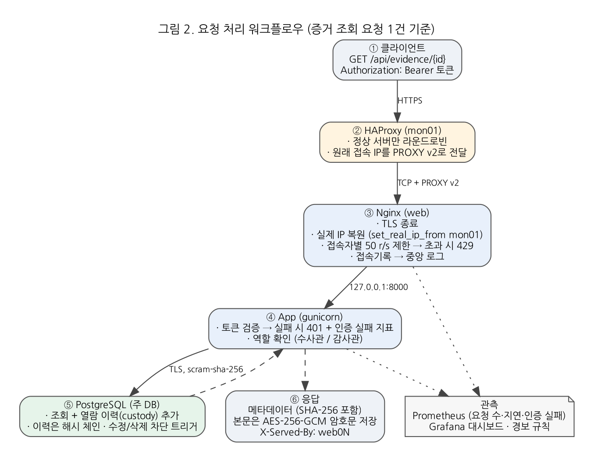

HAProxy는 TLS를 풀지 않는 TCP 모드로 동작하며, 원래 접속자 IP를 PROXY protocol v2 헤더로 넘긴다. Nginx는 mon01에서 온 연결에 한해 이 헤더를 믿고 실제 IP를 복원한다. 그래서 접속자별 요청 제한과 접속기록이 실제 접속자 기준으로 동작한다. 이 구조는 처음부터 있던 것이 아니라 부하 테스트에서 결함을 발견하고 고친 결과다(6.2절).

## 4.2 배포

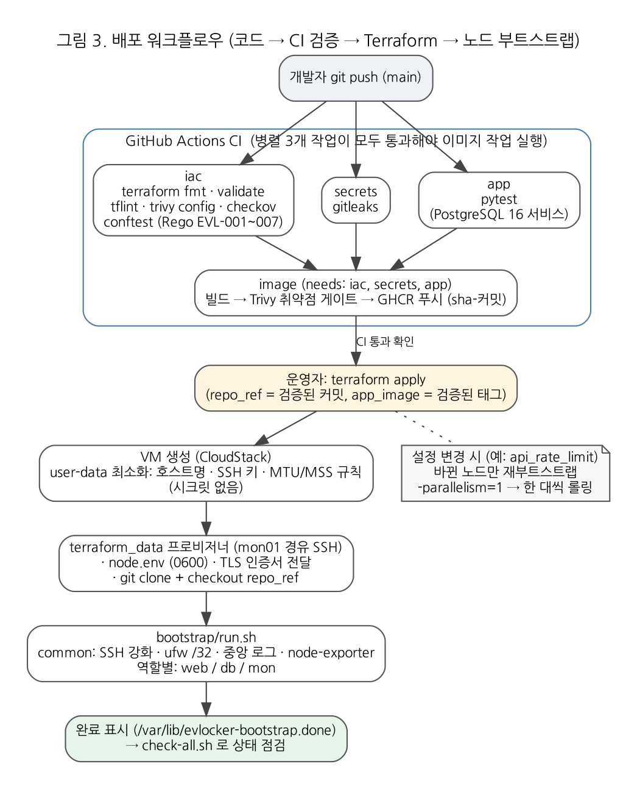

- **CI가 검증한 커밋만 배포한다.** `repo_ref`(부트스트랩 스크립트 버전)와 `app_image`(커밋 SHA 태그)는 CI를 통과한 값으로 고정한다.
- **user-data는 최소화한다.** 호스트명, SSH 공개키, MTU·MSS 규칙만 넣는다(678바이트). user-data는 VM 안에서 인증 없이 조회할 수 있어 시크릿을 둘 곳이 아니다.
- **시크릿은 Terraform 프로비저너가 mon01을 거친 SSH로 전달한다.** DB 비밀번호, 토큰, 암호화 키, TLS 개인키는 `random_password`·`tls_private_key`로 생성해 `/etc/evlocker/node.env`(0600)에 둔다.
- **설정 변경은 바뀐 노드만 다시 부트스트랩한다.** 노드별 환경 파일의 해시가 `triggers_replace`에 들어 있어서다. `-parallelism=1`로 한 대씩 롤링 교체한다.

## 4.3 장애·보안 사고 대응

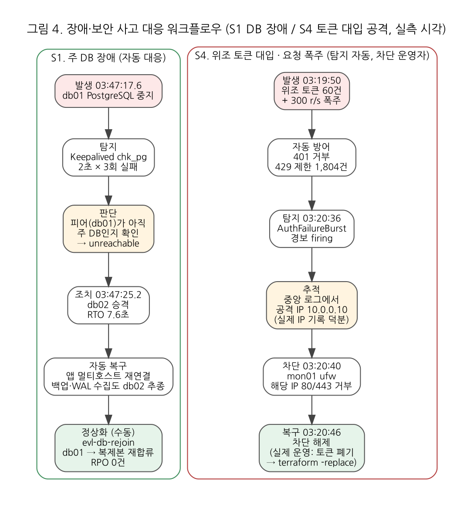

S1(DB 장애)은 탐지부터 승격까지 자동이고, 사람은 원인 확인과 재합류만 한다. S4(토큰 대입 공격)는 차단(401·429)과 탐지(경보)가 자동이고, 추적과 IP 차단은 운영자가 판단한다. 자동 차단을 넣지 않은 이유는 오탐으로 정상 사용자를 막는 위험 때문이다. 실제 운영에서는 일정 임계치 이상에서만 자동 차단하는 방식(fail2ban 등)을 검토할 수 있다.

# 5. 구축

## 5.1 Terraform 구성

```
terraform/
├── versions.tf      provider 고정 (cloudstack ~> 0.5.0, random ~> 3.6, tls ~> 4.0)
├── variables.tf     입력값 검증 (학번 8자리, UUID 형식, Small/Medium만, web_count 2~3, rate limit 1~5000)
├── data.tf          zone · template · offering 조회 (정규식 고정)
├── compute.tf       module "node" × 5 (for_each), SSH 키 precondition
├── provision.tf     노드별 env · 파일 생성, terraform_data 부트스트랩 (Bastion 경유)
├── secrets.tf       random_password × 8, AES 키, ECDSA P-256 자체서명 인증서
├── outputs.tf       service_url, ssh_config, 민감 출력은 sensitive
├── modules/vm/      cloudstack_instance (expunge = true)
└── policy/          Rego 정책 EVL-001 ~ 007
```

전체 리소스는 22개다. VM 5대, 부트스트랩 5개, 시크릿·인증서 11개, SSH 키 점검 1개로 이루어진다.

## 5.2 노드 부트스트랩

`bootstrap/run.sh`는 공통 단계 뒤에 역할별 스크립트를 실행한다. 모든 스크립트는 여러 번 실행해도 같은 결과가 나오게 작성했다. 그래서 실패한 노드만 `terraform apply`로 다시 돌릴 수 있다(트러블슈팅 12번).

| 단계 | 주요 내용 |
|---|---|
| common | 패키지 설치(재시도), SSH 강화(PasswordAuthentication no, PermitRootLogin no, MaxAuthTries 3, AllowUsers ubuntu), ufw 초기화 후 /32 규칙, rsyslog로 mon01 전송, node-exporter, 자동 보안 업데이트 |
| web | Docker(로그 journald, MTU 1400, no-new-privileges), Nginx 설정 렌더링, 앱 컨테이너 배포(`--read-only --cap-drop ALL`, 127.0.0.1에만 바인딩) |
| db | PostgreSQL 16(scram-sha-256, ssl=on, 접속·해제 로그, pgaudit), db01 초기화와 스키마, db02는 pg_basebackup으로 복제본 생성, Keepalived |
| mon | rsyslog 수신(400일 회전), HAProxy, 백업 키와 타이머, Prometheus·Grafana·Blackbox(Docker Compose) |

## 5.3 시크릿 관리

| 항목 | 처리 |
|---|---|
| Solid Cloud API 키 | `terraform.tfvars`(gitignore)에만 존재, 변수 `sensitive = true` |
| 서비스 시크릿 | Terraform이 생성. 출력은 `sensitive`이고, 필요할 때만 `terraform output -raw`로 셸 변수에 바로 넘김(화면에 출력하지 않음) |
| 노드 전달 | SSH로 전달해 0600 파일로 저장, 전달용 임시 파일은 즉시 삭제 |
| 저장소 | gitleaks를 CI에서 매 커밋 검사 |
| 한계 | Terraform state 파일에 시크릿이 평문으로 남는다. 로컬 파일이라 gitignore로 제외했지만, 운영 환경에서는 암호화된 원격 백엔드와 접근 통제가 필요하다 |

## 5.4 CI와 정적 분석

GitHub Actions에서 `iac`·`secrets`·`app` 작업이 병렬로 돌고, 셋이 모두 통과해야 `image` 작업이 실행된다.

| 실행 | 발견 | 조치 |
|---|---|---|
| 1차 | tflint 3건: 모듈 required_version 누락, provider 버전 제약 누락, CI 러너에 없는 SSH 키를 `file()`로 읽어 실패 | 버전 고정, `fileexists()` + precondition |
| 2차 | Trivy 이미지 CRITICAL 7건(베이스 이미지의 gnutls·openssl·perl) | 최종 스테이지에서 Debian 보안 업데이트 적용, 커밋 SHA 태그와 Trivy 게이트로 재현성 약화를 보완 |
| 정책 | conftest: 정상 plan은 0건 거부, 위반 plan은 7개 규칙 모두 거부 | - |

Rego 정책 중 EVL-001~004(네트워크 ACL, 포트 포워딩)는 VPC 구조에서 만든 규칙이다. Shared Network 전환 후에는 해당 리소스가 없어 검사 대상이 없다. VPC 구조로 되돌아갈 때를 대비한 안전장치로 유지했다. 대신 호스트 방화벽 규칙은 plan에 나타나지 않아 정책으로 검사할 수 없다. 이 부분은 배포 후 `port-audit.sh`로 확인한다(6.5절).

# 6. 측정 결과

측정 환경은 다음과 같다. 부하 발생기는 학생 PC(Windows, k6 v2.4.0)이고 OpenVPN을 거친다. 대상은 `https://<mon01>/`이다. 모니터링은 Prometheus(15초 수집)와 Grafana를 썼다. 원본 결과는 `evidence/`에 있다.

## 6.1 성능 (평상시)

| 측정 | 조건 | 요청 / 실패 | 처리량 | p50 | p95 | p99 | 최대 |
|---|---|---|---|---|---|---|---|
| smoke | 5명, 30초 | 359 / 0 | 11.6 req/s | 22.0ms | 30.3ms | 37.2ms | 62.7ms |
| baseline (수정 전) | 20명, 3분 | 13,400 / 0 | 74.2 req/s | 21.9ms | 39.8ms | 65.9ms | 300.6ms |
| **baseline (최종)** | 20명, 3분 | **13,463 / 0** | **74.5 req/s** | 21.6ms | **35.2ms** | 46.8ms | 116.1ms |

요청 구성은 단건 조회 60%, 사건별 목록 25%, 이력 조회 10%, 등록 5%다. 최종 구성에서 읽기 p95는 35.1ms, 쓰기 p95는 35.8ms로 목표(읽기 300ms, 쓰기 800ms)를 크게 밑돈다. PROXY protocol을 추가한 뒤에도 성능 저하는 측정되지 않았다. 차이는 측정 오차 범위다.

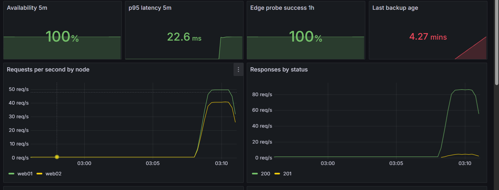

*그림 5. 최종 baseline 중 Grafana 대시보드. 가용성 100%, 5분 p95 22.6ms, 두 웹 서버에 요청 분산. Last backup age의 빨간색은 패널에 임계값을 지정하지 않아 Grafana 기본값(80초)이 적용된 것으로, 이후 16분·30분 기준으로 수정했다*


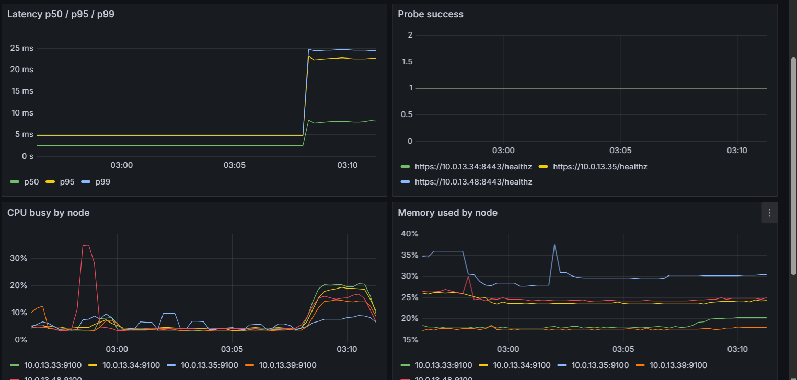

*그림 6. 같은 시간대의 지연 시간(p50·p95·p99)과 노드별 CPU. 웹 서버 CPU 약 20%*


## 6.2 부하 테스트에서 발견한 보안 결함

최대 200명까지 늘리는 stress 테스트에서 **실패율 76%**가 나왔다. 그런데 CPU는 30% 이하였고, 실패한 응답이 오히려 빨랐다(p50 13ms). Grafana의 노드별 요청 수 그래프는 정확히 **50 req/s에서 평평하게 잘려** 있었다.

| 관찰 | 원인 |
|---|---|
| 노드당 50 req/s에서 잘림 | Nginx의 접속자별 제한(50 r/s)과 같은 값 |
| 모든 요청이 한 접속자로 집계 | HAProxy가 TCP로 전달하면서 Nginx가 보는 출발지가 전부 mon01 IP |


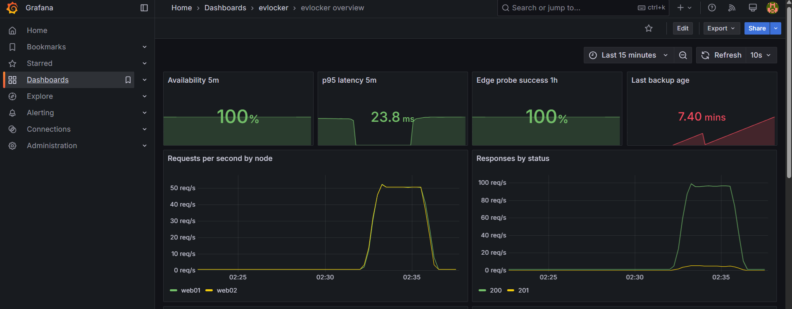

*그림 7. 수정 전 stress 테스트. 노드별 요청 수가 정확히 50 req/s에서 잘려 있다. CPU 여유가 있는데도 요청이 제한된 것이 결함의 단서였다*

이 결함은 성능 문제가 아니라 **보안 문제**였다.

1. **접속기록 결함.** 로그의 접속자 IP가 전부 mon01이라 접속기록 요건(접속지 정보)을 충족하지 못한다.
2. **정상 사용자 차단.** 한 사용자가 과도하게 요청하면 전체 사용자가 함께 제한된다(서비스 거부 증폭).
3. **접근 통제 우회.** `/metrics`를 mon01 IP에만 허용했는데, 외부 요청도 mon01을 거쳐 들어오므로 외부에서 조회할 수 있었다.

조치는 세 가지다. HAProxy에서 Nginx로 PROXY protocol v2를 적용했고, Nginx는 mon01에서 온 연결의 헤더만 신뢰하게 했다. 모니터링 수집은 전용 포트(8443)로 분리했다. 요청 제한 값은 Terraform 변수(`api_rate_limit`)로 뺐다. 수정 후 결과는 다음과 같다.

| 확인 항목 | 수정 전 | 수정 후 |
|---|---|---|
| 접속 로그의 접속자 IP | 전부 10.0.13.35 (mon01) | 10.0.0.10 (실제 접속자) |
| 외부에서 `/metrics` | 조회 가능 | **403** |
| 같은 stress 테스트 (PC 1대) | 76% 제한 | 76% 제한 (설계대로: 그 접속자만 제한) |
| 동시에 다른 접속자 요청 | 함께 제한 | **제한 없음** (401 정상 응답) |

수정 후에도 PC 한 대에서 보낸 stress는 76%가 제한된다. 이번에는 의도한 동작이다. 같은 시간에 다른 출발지(mon01 내부)에서 보낸 요청은 429 없이 처리되었다. 이 수정 덕분에 S4에서 공격자 IP를 추적할 수 있었다(7.2절).

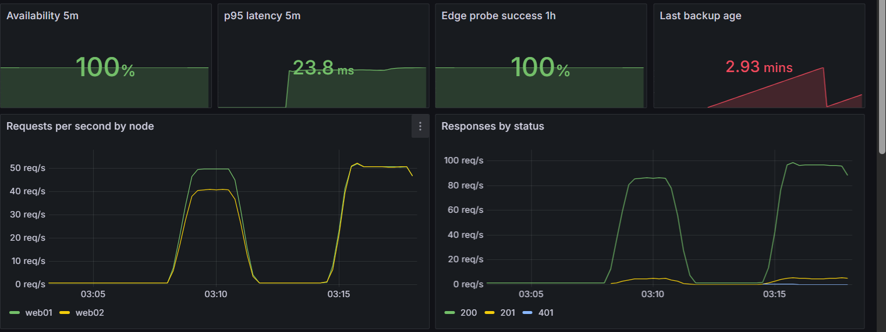

*그림 8. 수정 후 같은 stress 테스트. PC 한 대의 요청은 여전히 제한되지만, 같은 시간 다른 출발지 요청은 제한 없이 401로 처리되었다(Responses by status의 401 선)*


## 6.3 처리 한계와 병목

실제 처리 한계를 보려고 요청 제한을 5000으로 올렸다. 이 변경도 `terraform apply -var api_rate_limit=5000 -parallelism=1`로 적용했다. 그 상태에서 같은 stress(최대 200명)를 실행했다.

| 항목 | 값 |
|---|---|
| 요청 / 실패 | 58,357 / **1** (0.002%) |
| 평균 처리량 / 최고 | 276.9 req/s / 약 400 req/s (Grafana) |
| p50 / p95 / p99 / 최대 | 42.4ms / **307.5ms** / 1.11s / 3.42s |
| CPU 최고치 | web01·web02 약 75%, db01(주) 약 68%, db02 약 45%, mon01 약 20% |

- **한계점.** 약 400 req/s(200명)에서 p95가 목표 300ms를 넘었다. 평상시 부하(74.5 req/s)의 약 5배다.
- **병목.** 1 vCPU 웹 서버의 CPU가 가장 먼저 포화되었고, 주 DB가 바로 뒤를 따랐다. 웹만 늘리면 다음 병목은 주 DB다.
- **확장 방안.** 남은 할당량 1대로 `web_count = 3`을 적용하면 웹 처리량을 약 1.5배 늘릴 수 있을 것으로 추정한다(변수 검증으로 2~3대만 허용, 미측정). 그 이상은 읽기 요청(목록·이력 조회, 전체의 약 35%)을 복제본으로 보내는 읽기 분산이 필요하다.
- 측정 후에는 `terraform apply -parallelism=1`로 기본값 50을 복원했다.

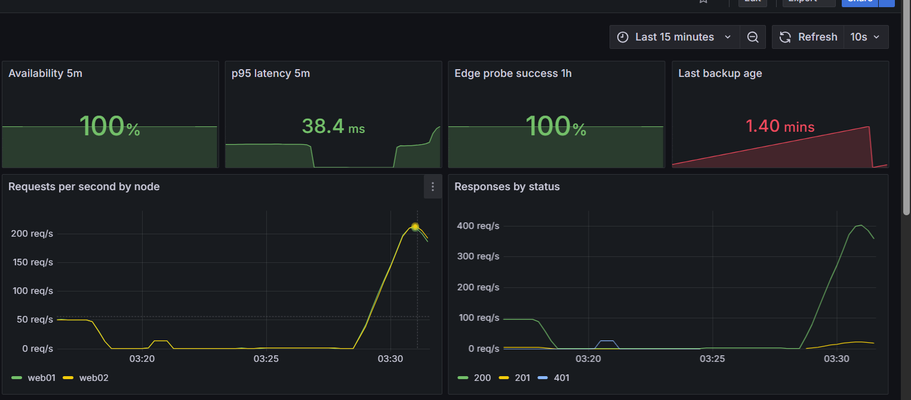

*그림 9. 처리 한계 측정(요청 제한 5000). 노드당 약 200 req/s, 전체 약 400 req/s까지 증가*


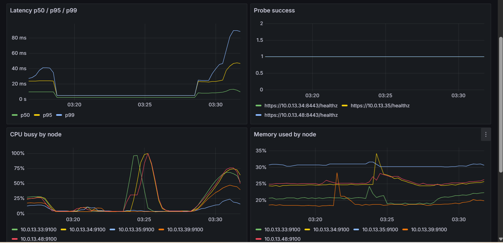

*그림 10. 같은 시간대 지연과 CPU. 웹 서버(10.0.13.34·48) 약 75%, 주 DB(10.0.13.33) 약 68%. 03:24~03:25의 웹 서버 CPU 급등은 요청 제한 변경으로 웹 서버를 다시 부트스트랩한 구간이다. 같은 시각 db01의 급등 원인은 확인하지 못했다*


## 6.4 가용성

### 웹 서버 장애

`scenario-web.sh`로 web01의 Nginx를 30초간 멈췄다. 0.2초 간격 probe로 측정했다.

| 시각 | 사건 |
|---|---|
| 03:43:48.2 | web01 Nginx 중지 |
| 03:43:51.4 | 요청 1건 실패 (중지 3.1초 후) |
| 03:43:53.1 | HAProxy가 web01을 DOWN 처리 (Connection refused), 이후 모두 web02 처리 |
| 03:44:20.8 | web01 Nginx 재시작 |
| 03:44:25.1 | HAProxy가 web01을 UP으로 자동 재투입 (재시작 4.3초 후) |

결과는 96건 중 1건 실패(98.96%)였다. 처리 서버 분포는 web01 25건, web02 70건이다. 상태 검사 설정(2초 × 2회)상 장애 감지까지 최대 4초 동안은 요청이 실패할 수 있다.

### 롤링 배포 중 가용성

| 배포 | 소요 | probe 결과 | 서버 측 확인 |
|---|---|---|---|
| 제한 5000 적용 (web 2대 순차 교체) | 1분 13초 | 269건 중 2건 실패 (502, 약 2.8초) | 앱 컨테이너 재시작 순간 |
| 제한 50 복원 | 2분 23초 | 248건 중 6건 실패 (000, 응답 없음) | 같은 시간 HAProxy 연결 271건 중 서버 오류 0건, 1건은 `CD`(클라이언트 측 종료) |

두 번째 배포의 실패 6건 중 5건은 교체가 시작되기 전에 발생했고, HAProxy 로그에는 서버 오류가 없었다. 그래서 측정 경로(학생 PC–VPN) 쪽 지연으로 판단했다. 측정값을 서버 로그와 교차 검증해 원인을 가린 사례다. 첫 번째 배포의 2.8초 중단은 교체 전에 HAProxy에서 해당 서버를 먼저 빼는 **드레이닝**을 넣으면 없앨 수 있다(9장).

### S1: 주 DB 장애 (7.1절 상세)

RTO는 **7.6초**, RPO는 **0건**이다. probe 127건 중 2건이 실패했다.

## 6.5 보안 점검

| 점검 | 방법 | 결과 |
|---|---|---|
| 외부 노출 포트 | `port-audit.sh` (5대 × 15개 포트) | mon01: 22·80·443. web01·web02·db01·db02: 없음 |
| 웹 서버 직접 접속 | PC → web01 443·8443·80 | 모두 차단 |
| 점검 도구 오탐 처리 | 1차 점검에서 web02:22 열림 판정 | ufw 규칙(`22/tcp ALLOW IN 10.0.13.35`만 존재), 커널 규칙(INPUT DROP), PC에서 직접 SSH 시도(timeout), 재시도 3회 모두 closed → **오탐**으로 확인 |
| 외부에서 `/metrics` | HAProxy 경유 요청 | 403 |
| 접속기록 | Nginx 접속 로그 | 실제 접속자 IP(10.0.0.10) 기록 |
| 백업 파일 권한 | `ls -l` | 백업 본문 `-rw-------`(root 전용) |
| 시크릿 위치 | user-data 내용 | 시크릿 없음 (호스트명·공개키·MTU 규칙만) |

## 6.6 백업과 복구

| 항목 | 결과 |
|---|---|
| 15분 덤프 | 암호화(AES-256-CBC, PBKDF2) + SHA-256 해시 파일. 4.0MB 덤프 0.69초 |
| 무결성 | 복원 전 해시 검증 `OK` |
| 복원 시간 | **7초** (첫 실행 23초는 PostgreSQL 이미지 다운로드 포함) |
| 복원 정확성 | 증거 4,581건, 이력 59,461건이 운영 DB와 일치 |
| 장애 후 연속성 | DB 승격 후에도 덤프와 WAL 수집이 새 주 DB를 자동으로 따라감 (WAL 타임라인 1 → 2) |

| 복구 수단 | RPO | 검증 수준 |
|---|---|---|
| 15분 암호화 덤프 | 최대 15분 | 복원 훈련 완료 |
| WAL 실시간 수집 | 수 초 이내 | 수집 동작 확인, 시점 복구(PITR) 훈련은 미실시 |

## 6.7 구축 재현성

| 회차 | 구조 | 작업 | 소요 | 결과 |
|---|---|---|---|---|
| 1 | VPC | apply | 2분 3초 | 성공 (부트스트랩 실패, 트러블슈팅 2번) |
| 2 | VPC | destroy → apply | 1분 6초 → 2분 58초 | 재생성 후 state 동일 |
| 3 | VPC | destroy → apply | 1분 5초 → 2분 45초 | VM 일부 SSH 키 미적용 (트러블슈팅 5~7번) |
| 4 | VPC | apply | 16분 56초 | 실패: mon01 DHCP 미수신 (트러블슈팅 8번) → 구조 전환 결정 |
| 5 | Shared | apply | **5분 19초** | **성공**, 22개 리소스 |
| 6 | Shared | destroy → apply | (최종 destroy 시 측정) → 5분 50초 + 재실행 34초 | web02 부트스트랩 중 SSH 끊김 → 해당 리소스만 재실행해 복구 |
| 7 | Shared | 설정 변경 (롤링) | 1분 13초 / 2분 23초 | 웹 2대만 순차 재부트스트랩 |

## 6.8 비용

과제 환경(Solid Cloud)은 학교가 제공해 비용이 0원이다. 같은 구성(1 vCPU, 2GB급 VM 5대, 공인 IP 1개)을 상용 클라우드에서 월 730시간 운영한다고 가정해 추정했다. 디스크·트래픽 요금은 제외했다.

| 기준 | 단가 | 월 추정 |
|---|---|---|
| 가비아 공공기관용 (1vCore·2GB, VAT 포함, 2026-10-30 확인) | 36,300원/대 + 공인 IP 5,500원 | **187,000원** |
| KT Cloud (1vCore·2GB, VAT 별도, 2026-10-30 확인) | 38,500~42,000원/대 | 192,500~210,000원 + 공인 IP |
| AWS 서울 t3.small (2 vCPU·2GB, 온디맨드) | 시간당 0.026달러 | 약 94.9달러 |

| 설계 선택 | 비용 효과 |
|---|---|
| 관리형 로드밸런서 대신 mon01의 HAProxy | LB 요금 절감. 대신 mon01이 단일 장애점(9장) |
| 모니터링·로그·백업·Bastion을 mon01 한 대에 통합 | VM 1~2대분 절감. 대신 장애 영향 범위가 넓음 |
| 웹 3대로 확장 시 | 1대 추가(약 36,300원/월)로 처리량 약 1.5배 (추정) |

단가는 비교 사이트와 각 사 공개 요금을 정리한 2차 자료 기준이며, 실제 계약 단가는 달라질 수 있다.

# 7. 시나리오 상세

## 7.1 S1: 주 DB 장애

**상황.** 주 DB(db01)의 PostgreSQL이 갑자기 중단된다.

**재현.** `scripts/scenario-db.sh`. db01에서 `systemctl stop postgresql`을 실행하고, 0.5초마다 db02의 승격 여부를 확인한다. 동시에 `/readyz`(DB 연결 확인) probe를 돌린다.

| 시각 | 사건 | 근거 |
|---|---|---|
| 장애 전 | db01 WAL `0/6BEBCE8`, db02 반영 위치 `0/6BEBCE8` (지연 0) | 스크립트 출력 |
| 03:47:17.6 | db01 PostgreSQL 중지 | 스크립트 |
| 03:47:19.4 | 첫 요청 실패 | probe |
| 03:47:22.2 | 마지막 요청 실패 | probe |
| 03:47:24 | db02 Keepalived `Entering MASTER STATE` | db02 journal |
| 03:47:24 | 승격 스크립트: 상대(db01) 주 DB 여부 확인 → `unreachable` → 승격 시작 | db02 journal (evl-failover) |
| 03:47:25.2 | db02 승격 완료 (`pg_is_in_recovery = f`) | 스크립트 |

**결과.**

- RTO **7.6초**(자동). probe 127건 중 2건 실패(98.43%). 나머지 요청은 앱 커넥션 풀이 새 연결을 기다린 뒤 성공했다.
- RPO **0건**. 장애 직전 WAL 위치가 같았고, 승격 후 증거 4,581건과 이력 59,461건이 모두 그대로였다.
- 앱 설정 변경은 없었다. 멀티호스트 연결이 쓰기 가능한 db02를 자동으로 찾았고, mon01의 백업·WAL 수집도 db02를 따라갔다.

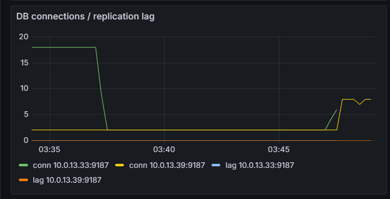

*그림 11. S1 중 DB 연결 수. 장애 후 db01(10.0.13.33)의 연결이 사라지고 db02(10.0.13.39)로 앱 연결이 넘어갔다(2개 → 8개)*


**정상화.** `evl-db-rejoin`으로 db01을 새 주 DB(db02)의 복제본으로 재합류시켰다. 이후 db02의 `pg_stat_replication`에 db01과 mon01이 `streaming`으로 확인되었다. 원래 역할로 되돌리지 않고 바뀐 구성을 유지했다. 되돌리는 작업 자체가 또 한 번의 중단이기 때문이다.

**한계.** 비동기 복제이므로 쓰기가 몰리는 순간에 장애가 나면 복제 지연만큼 유실될 수 있다. 이번 측정 시점에는 지연이 0이었다. 유실을 허용하지 않으려면 동기 복제(`synchronous_standby_names`)가 필요하다. 다만 이 경우 복제본 장애 시 쓰기가 멈추는 가용성 비용이 생긴다.

## 7.2 S4: 위조 토큰 대입과 요청 폭주

**상황.** 외부 공격자가 위조 토큰으로 API를 대입하고 대량 요청을 보낸다.

**재현.** `scripts/scenario-s4.sh`. 위조 토큰 60건을 보낸 뒤, k6로 위조 토큰 요청을 초당 300건씩 10초간 보낸다. 그 후 탐지·추적·차단·해제를 순서대로 수행한다.

| 시각 | 단계 | 결과 |
|---|---|---|
| 03:19:50 | 위조 토큰 60건 | 60건 모두 **401** |
| 03:20:04 | 초당 300건 폭주 (3,001건) | **429 1,804건**(요청 제한), 401 1,197건. 앱까지 간 요청도 전부 거부 |
| 03:20:36 | 탐지 | 5분간 인증 실패 1,290건, **AuthFailureBurst 경보 firing** (공격 시작 46초 후) |
| 03:20:36 | 추적 | mon01 중앙 로그의 `auth_failed remote=` 집계 → **10.0.0.10**이 1,257건 |
| 03:20:40 | 차단 | mon01 ufw에 해당 IP의 80·443 거부 규칙 추가 → 이후 접속 불가 |
| 03:20:46 | 해제 | 규칙 삭제 → 200 정상 |

**결과.**

- 인증 실패는 앱이 모두 거부했고, 과도한 요청은 Nginx가 앱에 닿기 전에 잘랐다.
- 공격 시작부터 차단까지 **50초**가 걸렸다(탐지 46초 + 추적·차단 4초).
- 공격자 IP 추적은 6.2절의 수정 덕분에 가능했다. 수정 전이었다면 모든 요청이 mon01 IP로 기록되어 추적할 수 없었다.

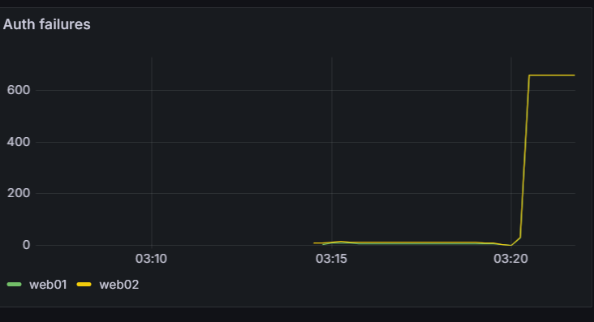

*그림 12. S4 중 인증 실패 지표. 03:20 공격 직후 급증해 경보 조건(5분간 20건 초과)을 넘었다*


**실제 운영이라면 추가할 대응.** 유출이 의심되는 토큰은 `terraform apply -replace=random_password.token_investigator`로 폐기·재발급한다. 웹 노드의 환경 파일 해시가 바뀌므로 웹만 롤링으로 다시 배포된다. 이후 접속기록 보존과 침해사고 보고 절차로 이어진다.

# 8. 설계 변경과 트러블슈팅

## 8.1 VPC에서 Shared Network로

| 구분 | VPC 3계층 (처음 설계) | Shared Network (최종) |
|---|---|---|
| 계층 분리 | 네트워크 ACL (호스트 침해와 무관) | 호스트 방화벽 /32 (root 권한 시 해제 가능) |
| 외부 진입 | 공인 IP + 포트포워딩 + VR 로드밸런서 | mon01 하나 (HAProxy + Bastion) |
| DB 전환 | Keepalived 가상 IP | libpq 멀티호스트 + Keepalived 승격 |
| 부팅 안정성 | VM마다 DHCP·user-data 수신이 불규칙하게 실패 | 5대 모두 정상 |

VPC에서 네 번 배포를 시도했다. MTU 블랙홀, netplan 교착, user-data 미적용을 차례로 고쳤지만, 같은 정의의 VM 중 일부가 가상 라우터에서 DHCP 주소를 받지 못하는 현상이 VM을 바꿔 가며 반복되었다. 학생 권한으로는 가상 라우터를 진단할 수 없었다. 그래서 원인 추적을 멈추고, 보안 요구(최소 노출, 접근통제)를 호스트 계층에서 충족하는 쪽으로 설계를 바꿨다. 네트워크 분리를 포기한 대가는 3.2절의 트레이드오프로 기록했다.

## 8.2 트러블슈팅 요약

| # | 증상 | 원인 | 조치 |
|---|---|---|---|
| 1 | plan에서 공개키 UTF-8 오류 | Windows 한글 컴퓨터 이름이 CP949로 키 주석에 저장 | 주석만 교체 |
| 2 | 부트스트랩 전부 미실행 | tfvars의 repo_url이 예시값 | 수정, plan 전 확인 절차 추가 |
| 3 | SSH 키 교환·다운로드가 중간에 멈춤 | VPC 경로 MTU 1450 vs NIC 1500 (PMTU 블랙홀) | MTU 1400 |
| 4 | 재배포 후 MTU가 1500으로 복귀 | 일회성 설정이 네트워크 재설정에 덮임 | netplan 고정 시도 |
| 5 | SSH 키·비밀번호 미적용 | bootcmd 안의 netplan apply가 cloud-init과 교착 | runcmd로 이동 |
| 6 | 네트워크 소실 | netplan 설정 충돌 | netplan 폐기 → MSS 클램핑(1360) + tcp_mtu_probing |
| 7 | 일부 VM만 user-data 미적용 | 큰 user-data 수신 실패 | user-data 678바이트로 축소, 시크릿은 프로비저너로 |
| 8 | mon01 DHCP 미수신, apply 17분 후 실패 | VPC 가상 라우터 전달 불안정 | Shared Network로 전환 |
| 9 | Grafana에 mon01 지표·백업 지표 없음 | mon01 방화벽이 Docker 대역의 9100 접근 차단 | 모니터링 대역 172.30.0.0/24 고정·허용 |
| 10 | stress 실패율 76%, CPU는 여유 | LB 뒤에서 모든 접속자가 mon01 IP로 보임 | PROXY protocol v2, 모니터링 포트 분리 (6.2절) |
| 11 | 백업 지표가 다시 사라짐 | 백업 파일 보호용 `umask 077`이 지표 파일까지 root 전용으로 만듦 | 지표 파일만 0644, mon01에 해당 스크립트 1개 핫픽스 |
| 12 | web02 부트스트랩만 실패 | 설치 중 SSH 세션 끊김(일시적) | 해당 리소스만 재실행(34초) |

9번과 11번은 모니터링 대시보드가 문제를 드러낸 사례다. 10번은 부하 테스트가 보안 결함을 드러낸 사례다. 11번의 핫픽스는 운영 중인 노드를 수동으로 바꾼 유일한 작업이다. 저장소의 수정 커밋을 그대로 받아 한 파일만 교체했고, 코드에도 반영해 다음 배포부터는 자동으로 적용된다.

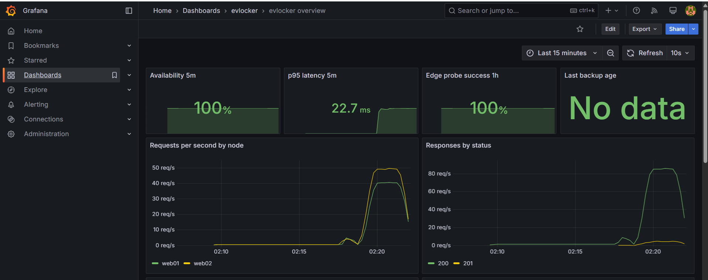

*그림 13. 트러블슈팅 9번 발견 당시. Last backup age가 No data이고, CPU 범례에 mon01(10.0.13.35)이 없다. 수정 후에는 그림 5처럼 값이 표시된다*


# 9. 한계와 개선 방안

| 한계 | 영향 | 개선 방안 |
|---|---|---|
| **mon01 단일 장애점** (LB, Bastion, 모니터링, 로그, 백업) | mon01 장애 시 서비스 접속 불가, 감시·백업도 중단 | HAProxy 2대 + Keepalived 가상 IP(플랫폼이 허용할 경우), 또는 관리형 LB. 모니터링·백업 서버 분리 |
| 백업이 같은 존(DKU)에 있음 | 국정자원 화재처럼 시설 단위 재해 시 원본과 백업을 함께 잃음 | 다른 존·다른 기관의 오브젝트 스토리지로 암호화 백업을 복제 (3-2-1 원칙) |
| 네트워크 계층 분리 없음 | 호스트 침해 시 방화벽 해제 가능 | VPC 문제 해결 후 ACL과 호스트 방화벽 이중 적용 |
| 비동기 복제 | 쓰기 집중 시 장애가 나면 소량 유실 가능 | 업무 중요도에 따라 동기 복제 검토 |
| 롤링 배포 중 약 3초 중단 | 교체 순간 일부 요청 실패 | 배포 전 HAProxy 런타임 API로 해당 서버 드레이닝 |
| PITR 훈련 미실시 | WAL 기반 복구 시간을 입증하지 못함 | 베이스 백업 + WAL로 특정 시점 복원 훈련 |
| Terraform state에 시크릿 | state 유출 시 전체 시크릿 노출 | 암호화된 원격 백엔드와 접근 통제, 또는 외부 비밀 관리 서비스 |
| 자체 서명 인증서 | 브라우저 경고, 중간자 공격 탐지 어려움 | 기관 인증서 또는 내부 CA |
| 호스트 방화벽이 정책 검사 밖 | 잘못된 규칙이 배포 후에야 드러남 | 방화벽 규칙을 Terraform 변수로 관리하고 Rego로 검사 |

# 10. 결론

보안·규제를 1순위로 두고 설계한 결과, 외부에 노출된 진입점은 하나다. 모든 내부 통신은 상대 IP 단위로 허용했고, 데이터는 전송·저장·백업 모든 단계에서 암호화했다. 접속기록에는 실제 접속자가 남는다. 가용성은 웹 장애에서 요청 1건, DB 장애에서 7.6초·유실 0건으로 측정되었다.

이번 과제에서 가장 크게 배운 것은 **측정이 설계를 바꾼다**는 점이다. 처음 설계에는 로드밸런서 뒤에서 접속자 IP가 사라지는 결함이 있었다. 이 결함은 코드 리뷰가 아니라 부하 테스트 그래프에서 드러났고, 고친 결과가 보안 사고 시나리오에서 공격자 추적을 가능하게 했다. 모니터링도 백업 지표 누락을 두 번 찾아냈다. VPC 문제처럼 원인을 끝까지 밝히지 못한 경우에는, 추적을 멈추고 요구사항을 다른 계층에서 충족하는 결정을 내렸다. 그 대가는 숨기지 않고 한계로 기록했다.

# 부록 A. 재현 방법

```bash
cd terraform
cp terraform.tfvars.example terraform.tfvars
terraform init
terraform apply
cd ..
bash scripts/ssh-setup.sh
bash scripts/check-all.sh
bash scripts/scenario-web.sh
bash scripts/scenario-db.sh
bash scripts/scenario-s4.sh
bash scripts/port-audit.sh
```

`terraform.tfvars`에는 api_key, secret_key, shared_network_id, repo_ref, app_image를 넣는다. 이 파일과 state 파일은 저장소에 포함하지 않는다.

# 부록 B. 증거 파일

| 파일 | 내용 |
|---|---|
| `evidence/k6-smoke.json`, `k6-baseline.json`, `k6-stress.json` | 수정 전 부하 테스트 |
| `evidence/k6-baseline-v2.json`, `k6-stress-v2.json`, `k6-capacity.json` | 최종 구성 부하 테스트, 처리 한계 |
| `evidence/rolling-deploy.csv`, `rolling-deploy-2.csv` | 롤링 배포 중 probe |
| `evidence/web-failover-*.csv`, `web-failover-*.txt` | 웹 장애 시나리오 |
| `evidence/s1-db-failover-*.txt`, `db-failover-*.csv` | S1 DB 장애 |
| `evidence/s4-*.txt` | S4 보안 사고 |
| `evidence/restore-drill-*.txt` | 백업 복원 훈련 |
| `evidence/port-audit.txt` | 포트·방화벽 점검 |
| `docs/captures/` | 보고서에 넣은 Grafana 화면 캡처 (그림 5~13) |
| `docs/troubleshooting.md`, `docs/static-analysis.md`, `ai-log.md` | 문제 해결, 정적 분석, AI 활용 기록 |
